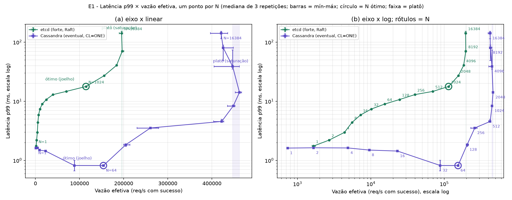
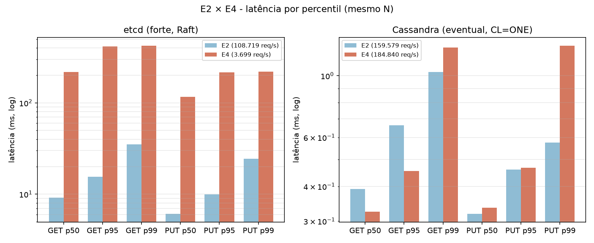
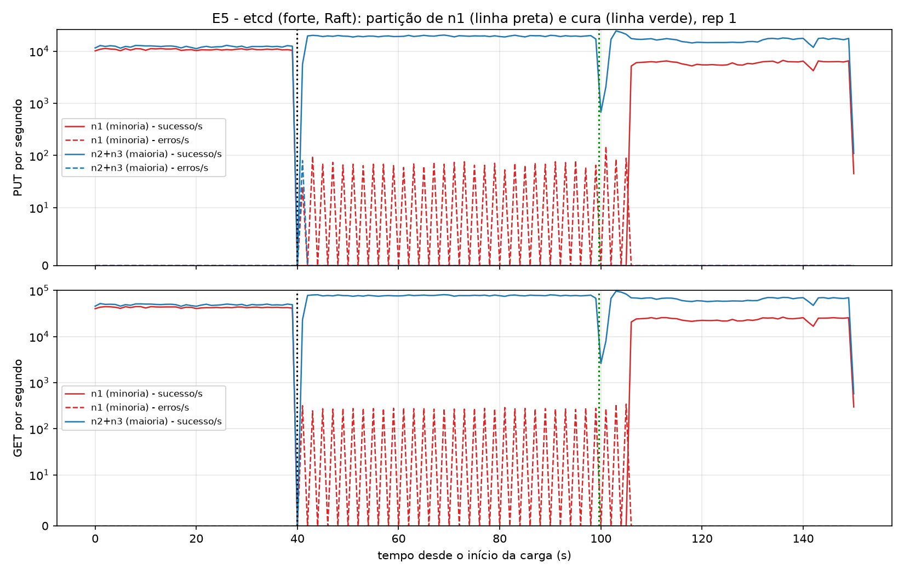
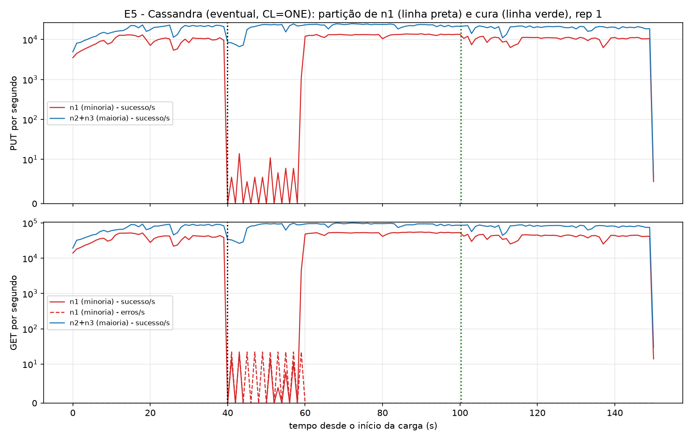
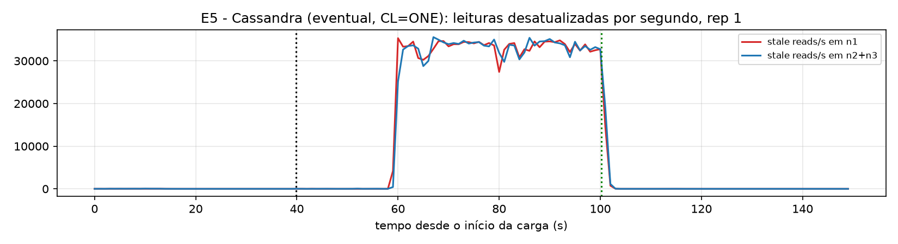
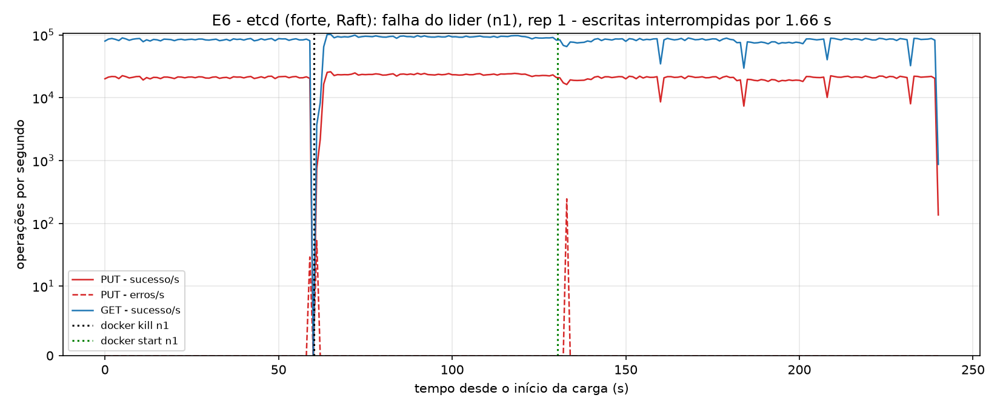
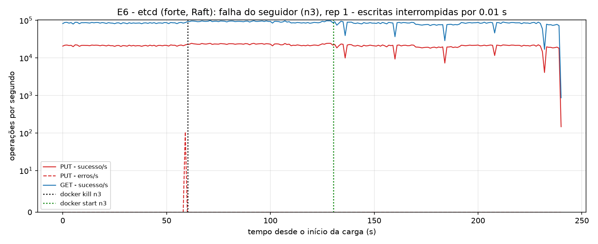
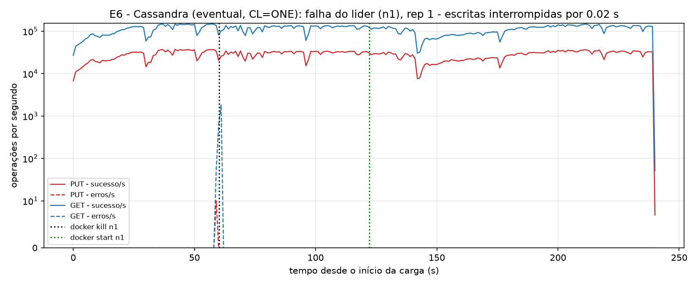
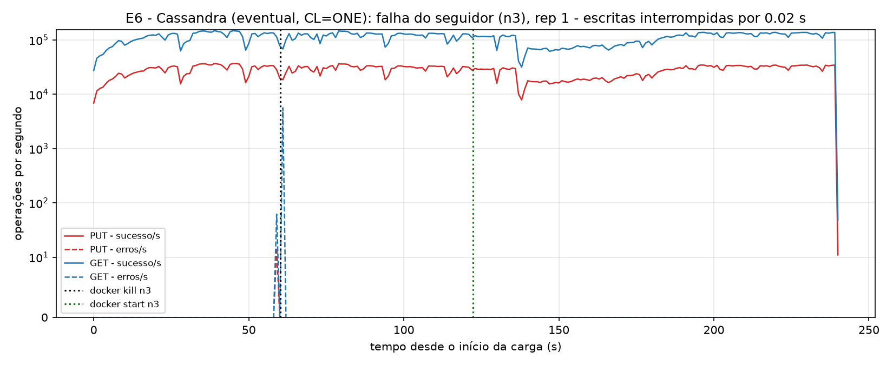

# 4. Resultados

## 4.1 E1 — Saturação

N = 1, 2, 4, …, 16384 (15 pontos), 2 min por ponto, 30 s descartados, 3 repetições (cada uma em cluster novo). O
enunciado sugere ir até 512, mas pede para continuar até a saturação estar clara (pelo menos dois pontos no platô).
Em N = 512 nenhum dos sistemas tinha saturado; por isso estendemos até 16384.

{{tabela:e1_tabela.md}}

*Tabela 1 — E1, mediana [mín-máx] de 3 repetições. vazão/p99 em req/s por ms (critério do ponto ótimo).*

{{tabela:e1_resumo.md}}

*Tabela 2 — Resumo do E1. Platô = pontos com vazão ≥ 95% da máxima.*

**Leitura das curvas.**

* **N = 1 (sem contenção).** etcd: 1.651 req/s, p50 de GET ≈ 0,5 ms e de PUT ≈ 1,2 ms (um round de replicação +
  fsync). Cassandra: 732 req/s, ≈ 1,4 ms por operação. O Cassandra é *mais lento* que o etcd sem contenção, embora
  faça menos trabalho de coordenação. Isso é custo da implementação (protocolo CQL, pools de threads da JVM com troca
  de contexto por requisição) e de gerenciamento de energia: com carga baixa, os núcleos dos nós Cassandra entram em
  estados de baixo consumo, e o p99 do Cassandra *cai* de 1,6 ms (N ≤ 16) para 0,8 ms (N = 32-64) quando a carga
  mantém os núcleos ocupados.
* **Região de crescimento.** No etcd a vazão cresce quase linearmente até N ≈ 1024, mas a latência sobe
  continuamente (1,8 → 18 ms de p99). O etcd agrupa em lotes (*batching*) as propostas Raft, os fsyncs do WAL e as
  confirmações de leitura (ReadIndex): mais clientes significam lotes maiores, com mais vazão pelo mesmo custo fixo
  por round, e cada requisição espera o lote. No Cassandra a vazão cresce até N ≈ 512 com p99 ainda abaixo de 5 ms.
* **Joelho (ótimo).** Pelo critério do enunciado (máximo de vazão/p99), N ótimo = **1024 no etcd** (114,5 mil req/s,
  p99 17,8 ms) e **64 no Cassandra** (154 mil req/s, p99 0,82 ms). A razão no ótimo do Cassandra (188 mil req/s por ms)
  é ~29 vezes a do etcd (6,4 mil).
* **Saturação.** etcd: platô em ~196 mil req/s (N = 8192 e 16384); dobrar N só dobra a latência (70 → 142 ms). Cassandra:
  platô em ~450-460 mil req/s (N = 1024 a 4096; em 8192 e 16384 a vazão até cai um pouco, ~420 mil, por sobrecarga de
  filas e GC). Comparando pelas curvas, e não pelo mesmo N: para qualquer p99 alvo, o Cassandra entrega 2,3-10 vezes
  a vazão do etcd, e sua vazão máxima sustentada é 2,35 vezes a do etcd.
* **Gargalo observado.** No platô do etcd, o líder (n1) usou ~360% dos 400% de CPU disponíveis e os seguidores
  ~260-310%. No Cassandra os três nós ficaram em ~400% (100% das suas 4 CPUs). O **gerador não saturou**: a
  utilização máxima das suas 16 CPUs foi 50% (etcd) e 63% (Cassandra), e não houve erros nem timeouts em nenhum ponto do
  E1. O platô reflete o cluster, não o gerador.

## 4.2 E2 — Baseline e E4 — Latência elevada

E2: N ótimo (etcd 1024, Cassandra 64), 3 min, sem falhas. E4: mesmo N, com
`tc qdisc replace dev eth1 root netem delay 50ms` na interface da rede entre nós (`lab_cluster`) dos três nós
(script `latencia_on.sh` do apêndice, executado num contêiner `nicolaka/netshoot` que compartilha o namespace de rede
do nó). O `ping` entre nós confirmou **RTT ≈ 100,1-100,2 ms** (p.ex. `rtt min/avg/max = 100.065/100.153/100.206 ms`
de n1 para n2), e o ping do gerador para n1 continuou em ~0,05 ms: o tráfego cliente-nó não sofre atraso. Os arquivos
`resultados/<sistema>/e4/netem_rep*.txt` e `rtt_rep*.txt` guardam a saída do `tc qdisc show` e dos pings.

{{tabela:e2_e4.md}}

*Tabela 3 — E2 × E4 (mesmo N), mediana [mín-máx] de 3 repetições.*

**etcd.** Com RTT de 100 ms entre nós, o PUT p50 foi de 6 ms para **117 ms** e o p99 de 24 para **219 ms**; o GET p50 foi
de 9 para **218 ms** e o p99 para **421 ms**. Com N fixo (1024) em loop fechado, a vazão caiu de 109 mil para **3,7 mil
req/s** (−97%). Pela lei de Little, X = N / R: com a latência média subindo ~30 vezes, a vazão cai na mesma proporção.
O cluster não ficou mais lento por falta de recursos (a CPU do gerador caiu para 5%); os clientes passam o tempo
esperando rounds de rede. A explicação em rounds está na resposta à pergunta 1 (seção 5).

**Cassandra.** Latência e vazão praticamente não mudaram: PUT p50 0,32 → 0,34 ms, GET p50 0,39 → 0,33 ms, e
a vazão até *subiu* de 159,6 mil para 184,8 mil req/s (+16%). Nenhuma operação com CL = ONE espera a rede entre nós: o
coordenador também é réplica (RF = N = 3), responde com a própria gravação ou leitura local e só depois propaga a
escrita para as outras réplicas, de forma assíncrona. O aumento de vazão provavelmente vem do *dynamic snitch*: no E2
as três réplicas têm latências parecidas e parte das leituras ONE vai a uma réplica remota (um salto a mais entre
nós). Com 100 ms de RTT, a réplica local passa a ser sempre a escolhida, o que é coerente com a queda do GET p95
(0,66 → 0,45 ms). O PUT p99 subiu de 0,58 para 1,28 ms: cada mutação enviada às réplicas remotas fica 100 ms em voo
(mensagens e *callbacks* pendentes no coordenador), o que aumenta memória e pausas de GC. O atraso da rede não aparece
na latência, e sim na consistência (E3).

Variação no E2 do etcd: uma das três repetições teve vazão de 71 mil req/s (as outras, 109 e 115 mil), porque a vazão
desabou para ~15 mil req/s nos últimos ~60 s da execução. O fenômeno também apareceu em uma repetição do E6, é
analisado na seção 4.6 e é atribuído à implementação (compactação periódica do histórico MVCC no bbolt).

## 4.3 E3 — Stale reads

Coordenador (`gerador stale`): PUT(k, v) com v único e crescente no **n1**; só depois do retorno com sucesso, GET(k) no
**n3**. É *stale* se o valor lido < v. PUT com erro ou timeout não é confirmado e não gera GET. Rodamos 8 coordenadores
independentes em paralelo, cada um com sua chave (`stale-0` … `stale-7`) e seu próprio par sequencial PUT → GET, até
somar ≥ 10.000 pares por condição (isso só reduz o tempo total, já que cada par continua estritamente sequencial). No
etcd a liderança foi colocada no n1 antes do experimento (`etcdctl move-leader`): o PUT vai ao líder e o GET a um
seguidor, o caso mais desfavorável para leituras locais.

Níveis configurados: **etcd** — PUT confirmado após *commit* por quórum (2 de 3, com fsync) e aplicação no líder; GET
**linearizável** (ReadIndex) e, como variante declarada, `serializable` (leitura local no n3). **Cassandra** — PUT e GET
com **CL = ONE** (R + W = 2 ≤ RF = 3); o PUT confirmado só garante a gravação em uma réplica (commit log + memtable,
sem fsync imediato).

{{tabela:e3.md}}

*Tabela 4 — E3, 3 repetições de ≥ 10.000 pares por condição. "atraso máx." = maior diferença entre o v escrito e o lido.*

* **etcd linearizável: 0 stale reads** em 60.041 pares, com e sem atraso. Não há anomalia na classe forte, o que confirma
  a configuração. O custo aparece na latência: com RTT de 100 ms, PUT ≈ 103 ms (1 round líder → quórum) e GET no
  seguidor ≈ 299 ms (seguidor → líder, round de heartbeat do líder ao quórum, resposta ao seguidor, mais a espera pelo
  lote de ReadIndex em andamento).
* **etcd serializable** (variante): **62%** de stale reads com a rede original e **99,9%** com atraso. O PUT retorna
  assim que o líder e *um* seguidor gravaram; o n3 pode ainda não ter recebido ou aplicado a entrada. Com 50 ms por
  sentido, o n3 só recebe o *commit* ~50 ms depois do retorno do PUT, enquanto o GET local leva 0,4 ms; por isso
  quase todas as leituras ficam 1 versão atrás. O mesmo sistema vira "eventual" quando a leitura dispensa o quórum.
* **Cassandra CL = ONE:** com a rede original, **0,55%** de stale reads (0, 55 e 183 nas três repetições, até 4 versões atrás). O PUT
retorna assim que o n1 grava localmente; a mutação chega ao n3 em ~0,1 ms, mas às vezes o GET chega antes, sobretudo
quando o n3 está ocupado. Com +50 ms por sentido: **99,3%** de stale reads, até **137 versões** atrás. O n3 só recebe
cada escrita ~50 ms depois, enquanto um par PUT → GET leva ~2,5 ms, então o n3 fica permanentemente dezenas de
versões atrás. O PUT continua rápido (~1,2 ms): quem paga o atraso da rede é a consistência, não a latência. Ao
contrário do etcd, aqui não se trata de erro de configuração: CL = ONE não promete ler a última escrita confirmada.

## 4.4 E5 — Partição de rede

Carga do E2 (threads fixas: 1/3 dos clientes em cada nó). Linha do tempo: t = 40 s isola o n1 (`docker network
disconnect lab_cluster n1`, script `particao.sh`), t = 100 s cura (`cura.sh`, reconecta com o mesmo IP), t = 150 s fim.
A verificação obrigatória do apêndice (A.9) foi registrada em todas as repetições (`verificacao_particao.txt`):
n2 → n3 responde (RTT 0,02 ms), n1 → n2 falha (100% de perda) e o gerador continua alcançando o n1 (0,02 ms). No etcd o
n1 era o líder no momento da partição. Depois da carga, as 10.000 chaves foram lidas em cada nó (etcd:
leitura serializable, ou seja, o estado local; Cassandra: CL = ONE com o próprio nó como coordenador) até os três
concordarem.

{{tabela:e5.md}}

*Tabela 5 — E5: operações iniciadas durante a partição (60 s), por lado. "stale reads" = GET que devolveu uma versão
estritamente anterior à última escrita confirmada (concluída antes do início do GET); "escritas confirmadas perdidas" =
PUT confirmado cujo valor não está no estado final e foi sobrescrito por uma escrita que terminou antes dele começar.*

**etcd (CP).** Ao isolar o líder n1, os seguidores n2/n3 deixam de receber heartbeats e, após o election timeout
(~1 s), elegem um novo líder (termo 3 → 4) com quórum 2 de 3. O n1, sem ouvir a maioria (CheckQuorum), deixa de ser
líder. No **lado minoritário** praticamente tudo falha: ~8.200 GET e ~2.100 PUT terminaram em timeout de 2 s. As
poucas operações bem-sucedidas (~200 GET e ~100 PUT) foram as iniciadas nos ~100 ms entre o registro do evento e a
desconexão efetiva. O padrão "pente" dos erros a cada 2 s vem do loop fechado: as ~341 threads do n1 expiram juntas e
recomeçam juntas. No **lado majoritário**, só 26-87 PUTs falharam (os que estavam em voo durante a eleição); depois a
vazão até *subiu*, porque as threads presas no n1 deixam de competir. Não houve stale reads, nenhuma escrita
confirmada foi perdida e, após a cura, o n1 voltou como seguidor e as réplicas ficaram idênticas. O n1 só voltou a
servir ~6 s após a cura. Ficou ~1,1 milhão de entradas para trás, muito além das 5.000 que o líder mantém em memória
após cada snapshot, e por isso precisa receber um *snapshot* do banco antes de voltar a atender.

**Cassandra (AP).** Os dois lados continuaram aceitando escritas: **0 PUTs com erro** em todas as repetições, com
~530 mil PUTs confirmados no lado do n1 e ~1,28 milhão no lado n2+n3 durante os 60 s. Como CL = ONE exige só uma
réplica e todo nó é réplica de todas as chaves, cada lado confirma escritas sozinho. O preço foi a consistência:
**~1,3 milhão de stale reads em cada lado por repetição** (~64% das leituras no lado do n1, ~26% no lado majoritário).
O n1 não vê as escritas de n2/n3 e vice-versa, como mostra a figura de stale reads, que salta assim que os dois lados
passam a escrever.

O lado do n1 ainda teve uma **indisponibilidade parcial de ~19,5 s** logo após a partição (19,5 / 19,6 / 19,6 s nas três
repetições): leituras CL = ONE encaminhadas pelo coordenador a réplicas remotas (o *dynamic snitch* escolhe pela
latência, não necessariamente a réplica local, e a *speculative retry* tenta a outra réplica remota, também
inalcançável) ficaram presas até o timeout de 2 s do cliente (as ~220 falhas de GET);
as escritas não falharam. A duração corresponde ao detector de falhas φ-accrual: com gossip a cada ~1 s e o modelo
exponencial do Cassandra, φ(t) = t / (1 s · ln 10) atinge `phi_convict_threshold` = 8 em t ≈ 18,4 s. Nesse momento n2/n3
são marcados DOWN (ver `nodetool_n1_particao.txt`: n1 vê n2/n3 como `DN`, e n2 vê n1 como `DN`) e as leituras passam a
ser locais. Disponibilidade, mas só depois da detecção da falha.

**Reconciliação.** Durante a partição cada coordenador guardou *hints* para as réplicas inalcançáveis. Na cura, o gossip
remarcou os nós como UP e os hints foram entregues: os stale reads voltaram ao nível normal **~3,7-4,0 s após a cura** e,
após a carga, as três réplicas estavam idênticas na primeira leitura completa. As chaves escritas dos dois lados foram
reconciliadas por *last-write-wins* (maior timestamp da célula). **Nenhuma escrita confirmada foi perdida** no sentido
da Tabela 5 (nenhum valor final é anterior, em tempo real, a uma escrita confirmada), porque todos os timestamps vêm do
relógio do gerador. Ainda assim, em cada chave escrita dos dois lados só a versão de maior timestamp sobreviveu, e as
escritas do outro lado foram descartadas sem que nenhum cliente fosse avisado do conflito. Durante a partição, leituras
de cada lado viram estados que nunca existiram do ponto de vista do outro.

## 4.5 E6 — Falha de nó (failover)

Carga do E2, mas com o cliente conhecendo os 3 nós (`-pin=false`), para que o driver redirecione as requisições (como
recomenda o apêndice A.10). Linha do tempo: t = 60 s `docker kill`, t = 120 s `docker start`, t = 240 s fim.
(a) **líder**: etcd — n1, para onde a liderança foi transferida antes; Cassandra — não há líder, então matamos o n1
(nó semente e primeiro *contact point* do driver; com balanceamento round-robin todos os nós atendem 1/3 das
requisições). (b) **seguidor**: n3 nos dois sistemas. O instante do kill é registrado logo após o `docker kill` retornar
(precisão de ~0,1 s).

{{tabela:e6.md}}

*Tabela 6 — E6, mediana [mín-máx] de 3 repetições. "maior intervalo sem PUT ok" = maior intervalo entre conclusões
de PUT bem-sucedidas no entorno do kill (indisponibilidade de escrita); "kill → escritas voltam" = do kill ao fim desse
intervalo; "vazão pós-restart / pré-falha" compara 50 s de vazão, a partir de 60 s após o restart, com os 30 s anteriores
ao kill.*

**etcd, líder.** As escritas ficaram totalmente interrompidas por **1,4 s** (mediana; 1,0-1,7 s) e voltaram ~1,2 s após o
kill. Composição: detecção pelos seguidores (nenhum heartbeat por um *election timeout* de 1000 ms, aleatorizado),
PreVote + eleição (1 round a um quórum, < 1 ms nesta rede) e reconfiguração do cliente (o gRPC já tinha conexões
abertas com os outros dois nós; as requisições em voo para o n1 morto expiraram ou falharam). Houve só ~50 erros
(0,00% das operações da janela). As leituras linearizáveis também pararam, porque o ReadIndex precisa de um líder.

**etcd, seguidor.** **Nenhuma interrupção** (maior intervalo sem PUT ok = 10 ms; 0 erros): o líder continua com
quórum (2 de 3) e o cliente deixa de usar o n3.

**Após o restart (etcd).** O nó volta como seguidor e recebe as entradas que perdeu (ou um snapshot). Em 5 das 6
repetições a vazão voltou a ~95% da anterior. Em uma repetição de "líder" a vazão caiu para ~14% a partir de ~127 s (sem
erros) e não voltou até o fim. Não foi efeito do restart: é o mesmo colapso ligado à compactação descrito na seção 4.6.

**Cassandra.** **Nenhuma interrupção de escrita** em nenhuma variante: o maior intervalo sem PUT ok foi de 20 ms, o
mesmo da operação normal. Não há líder nem eleição: qualquer nó vivo coordena e, com CL = ONE, uma réplica viva basta.
Os únicos erros (2,4-5,6 mil por repetição, ~0,03-0,06% das operações da janela) concentram-se no primeiro segundo
após o kill. São requisições em voo no nó morto ou enviadas a ele antes de o driver perceber a falha. O kernel fecha
os sockets do processo morto, o gocql vê as conexões caírem e passa a usar só os dois nós vivos (o evento DOWN do
gossip vem depois). Leituras que um coordenador vivo encaminhou à réplica morta são reenviadas a outra réplica pela
*speculative retry* (padrão `99p`), por isso não há erros depois disso. As variantes "líder" (n1) e "seguidor" (n3) se
comportam igual, como esperado num sistema sem líder. **Após o restart**, o nó leva ~15 s para voltar a aceitar
conexões CQL (inicialização da JVM e *replay* do commit log). Quando o driver volta a usá-lo, a vazão total cai ~50% e
se recupera ao longo de ~40-50 s (JIT frio, entrega de *hints* acumulados, compactações), sem erros; de 60 a 110 s
após o restart a vazão já estava em 100-106% da anterior à falha.

## 4.6 Anomalia de implementação observada no etcd

Em 2 das 12 execuções longas do etcd com N = 1024 e alta vazão (E2 rep. 3 e E6-líder rep. 3; E2, E5 e E6), a vazão desabou para ~13-15% (de
~115 mil para ~15 mil req/s), sem erros, e não se recuperou até o fim da execução. Em todos os nós o p50 subiu
~5-7 vezes ao mesmo tempo (PUT no líder: 4,5 → 29 ms). Para diagnosticar, repetimos o E2 do etcd 3 vezes guardando
os logs dos nós (`resultados/etcd/e2_diag/`, fora das médias) e o colapso se reproduziu em uma delas (77 mil req/s).
Os logs mostram que:

* a compactação automática periódica (`--auto-compaction-retention=1m`) roda a cada minuto. A segunda, ~116-118 s após o
  início da carga, é a primeira que remove muito histórico: ~2,7 milhões de revisões (2 min × ~23 mil PUT/s). Ela levou
  **19,4 s** na execução sem colapso e **29,2 s** na com colapso, e nos três casos de colapso a queda começou nesse
  instante (116-127 s);
* mesmo sem colapso, a vazão cai 20-30% enquanto a compactação roda (de ~115 mil para ~80-100 mil req/s) e depois
  volta;
* na execução com colapso, os **seguidores** emitiram ~3.000 avisos `apply request took too long` (leituras `range` de
  uma única chave levando > 100 ms), contra ~110 na execução normal, e continuaram emitindo até o fim, depois de a
  compactação terminar. O líder quase não emitiu. Não houve envio de snapshot nem troca de líder.

Interpretação: a remoção em massa de revisões no bbolt (B+tree com um único escritor) degrada o caminho de leitura e
aplicação dos seguidores. Leituras linearizáveis nos seguidores (2/3 dos clientes) ficam lentas e, em loop fechado,
as threads se acumulam nelas; o líder também desacelera porque precisa dos acks desses mesmos seguidores. É um efeito
da **implementação** (MVCC + bbolt + política de compactação), não do consenso. A configuração recomendada para essa
taxa de escrita seria compactar com mais frequência, por revisão, e desfragmentar periodicamente. Mantivemos as 3
repetições originais nas tabelas (mediana e variação), como pede o enunciado.

# 5. Respostas às perguntas

**1. Como a latência de escrita (p99) e a vazão de cada sistema responderam à rede com latência elevada (E4)?
Explique em rounds de mensagens e quórum, considerando o coordenador/líder.**

*etcd.* Uma escrita no Raft precisa de **um round de replicação do líder a um quórum** (AppendEntries → ack de pelo
menos 1 seguidor, que grava e faz fsync antes de responder). Com 50 ms por sentido, isso é 1 RTT = 100 ms para o
cliente conectado ao líder. Para os 2/3 dos clientes conectados a seguidores há mais meio round em cada ponta:
seguidor → líder (50 ms) e o aviso de *commit* de volta ao seguidor, que só então aplica e responde (50 ms), somando
~200 ms. Isso corresponde aos degraus medidos: PUT p50 = 117 ms (em loop fechado, os clientes do líder completam 2×
mais operações e dominam a mediana) e PUT p95/p99 = 215/219 ms. A leitura linearizável (ReadIndex) também custa
**um round a um quórum**: o líder confirma que ainda é líder com heartbeats antes de responder, 100 ms no líder e
~200 ms via seguidor. Leituras que chegam com um round já em andamento esperam o próximo, daí GET p99 ≈ 421 ms ≈ 4 RTT.
Em termos de CGR, o etcd opera como o *leader-driven consensus* em uma época estável (§5.3.4): cada decisão custa só
a fase de escrita/aceitação da *epoch consensus* (§5.3.3) a uma maioria, porque a fase de leitura é amortizada pela
troca de época (§5.3.2). A latência mínima é, portanto, ≥ 1 RTT ao quórum, e não há como escondê-la. Como N é fixo, a
vazão caiu 97% (109 mil → 3,7 mil req/s) pela lei de Little ($X = N / \bar{R}$).

*Cassandra.* Com CL = ONE, o coordenador (que também é réplica, porque RF = N = 3) grava localmente, dispara as
mutações para as outras duas réplicas em paralelo e **responde ao primeiro ack, o seu próprio**; a leitura ONE é
atendida pela réplica mais próxima, normalmente a local. Não há round de rede no caminho crítico, nem de escrita nem
de leitura: o PUT p99 foi de 0,58 para 1,28 ms e a vazão de 159,6 mil para 184,8 mil req/s.
O atraso só aparece na propagação assíncrona, ou seja, em stale reads (E3). Se usássemos QUORUM (W = 2), cada escrita
pagaria 1 RTT, como no etcd, mas sem líder: o coordenador falaria direto com as réplicas, sem o salto extra
seguidor → líder.

**2. O que limitou a vazão de cada sistema no E1? Por que o consenso restringe o scale-out de escritas? Que
características da implementação contribuíram?**

*etcd:* a **CPU do líder** (~90% das suas 4 CPUs no platô, contra ~65-75% nos seguidores). Todas as escritas passam
pelo líder, que serializa o log, envia AppendEntries a cada seguidor, coleta acks, aplica no bbolt (escritor único) e
ainda participa de cada lote de ReadIndex das leituras linearizáveis de todos os nós. O consenso restringe o
*scale-out* de escritas porque (i) há uma única sequência de decisões (o log, equivalente a *total-order broadcast*,
CGR §6.1) ordenada por um único líder (§5.3.4); (ii) toda escrita precisa ser persistida por uma maioria, e cada
réplica aplica *todas* as escritas, então adicionar nós não divide o trabalho de escrita, só aumenta o fan-out do
líder e o tamanho do quórum (CGR §2.7.3: quóruns de maioria precisam se intersectar). Mais nós aumentam a tolerância a
falhas, não a vazão de escrita. Contribuições da implementação: *batching* agressivo de propostas e de fsync (por isso
a vazão cresce até N muito alto, à custa de latência), gRPC/protobuf e HTTP/2 por requisição, MVCC com histórico de
revisões e compactação periódica, coletor de lixo do Go e o snapshot do Raft a cada 10.000 entradas (~2 por segundo nesta carga). A compactação do
histórico chegou a derrubar a vazão para ~15% em 3 de 15 execuções longas (seção 4.6).

*Cassandra:* a **CPU dos três nós** (100% das 4 CPUs de cada um). Cada nó é coordenador de 1/3 das requisições e réplica
de 100% das escritas (RF = 3). Não há ponto único de serialização: cada nó aceita escritas sem coordenar a ordem com os
demais. Assim a vazão escala com o número de nós (para RF fixo), o que o modelo eventual permite e o consenso não.
Implementação: SEDA/pools de threads da JVM, parsing CQL, memtables/commit log sem fsync síncrono (`periodic`),
coletor de lixo (o platô *cai* em N = 8192-16384) e o custo fixo alto por requisição visto em N = 1.

**3. Quais stale reads foram observados e em que condições?**

Ver Tabela 4. etcd linearizável: **nenhum**, em nenhuma condição. A leitura passa pelo quórum (ReadIndex) e equivale ao
registrador atômico de CGR §4.3/§4.4, em que a leitura "consulta a maioria" antes de responder. etcd serializable
(variante): 62% (rede original) e 99,9% (+50 ms). Cassandra CL = ONE: **0,55%** com a rede original (238 em 30.021 pares, até 4 versões atrás) e **99,3%** com +50 ms (até 137 versões atrás). Com R + W ≤ RF, o quórum de leitura (1
réplica) não intersecta necessariamente o de escrita (1 réplica), o caso de *regular/atomic register* sem interseção de
maioria (CGR §4.2.3 e §2.7.3). O valor lido pode ser antigo, embora convirja depois. Na partição (E5) os stale reads do
Cassandra chegaram a ~64% das leituras no lado do n1 e ~26% no lado n2+n3.

**4. Na partição (E5), o que ocorreu com escritas e leituras em cada lado? Qual sistema priorizou C e qual A? O que
aconteceu na reconciliação?**

O **etcd priorizou C** (CP): o lado minoritário (n1) ficou indisponível para leituras e escritas (timeouts), e o lado
majoritário elegeu um novo líder em ~1 s e seguiu atendendo, sem stale reads nem perda de escritas confirmadas. Na
cura, o n1 voltou como seguidor (PreVote evitou que ele disparasse uma eleição com termo inflado), precisou de um snapshot
e voltou a servir ~6 s depois; os três nós ficaram idênticos e não houve "reconciliação" de conflitos, porque só a
maioria aceitou escritas. O **Cassandra priorizou A** (AP): os dois lados continuaram aceitando leituras e escritas
(0 PUTs com erro), ao custo de ~1,3 milhão de stale reads em cada lado por repetição. O lado do n1 ainda teve uma
indisponibilidade parcial de ~19,5 s logo após a partição: leituras roteadas pelo *snitch* para réplicas inalcançáveis
ficaram presas até o detector φ-accrual (limiar 8, ou seja, ~18,4 s com gossip de 1 s) marcar n2/n3 como DOWN. Na reconciliação, os *hints* acumulados pelos
coordenadores foram entregues quando o gossip viu os nós de novo, e os stale reads cessaram ~4 s após a cura. Os
conflitos (a mesma chave escrita nos dois lados) foram resolvidos por *last-write-wins*. Como os timestamps vêm de um
único relógio (o do gerador), o LWW respeitou a ordem de tempo real: **0 escritas confirmadas perdidas** no sentido da
Tabela 5. Mesmo assim, uma escrita confirmada de um lado foi silenciosamente sobrescrita por outra concorrente do outro
lado sem que nenhum cliente visse as duas; com relógios de clientes dessincronizados, o LWW pode descartar a escrita
mais recente. É o teorema CAP (Gilbert & Lynch [6]): durante a partição, o etcd abriu mão da disponibilidade no lado
minoritário e o Cassandra da consistência nos dois lados.

**5. Qual foi o tempo de failover no E6 em cada sistema e o que o determinou?**

*etcd, líder:* escritas interrompidas por 1,4 s (mediana), quase todo ele **detecção de falha + timeout de eleição**
(election timeout de 1000 ms aleatorizado; o seguidor só se candidata quando o tempo sem heartbeat do líder passa
desse valor), mais um round de PreVote/voto a um quórum. A **reconfiguração do cliente** foi praticamente nula, porque
o cliente já tinha conexões abertas com os três nós; só as requisições em voo para o nó morto foram perdidas. Em
termos de CGR, é o detector $\Diamond\mathcal{P}$ / líder eventual $\Omega$ (§2.6.4-2.6.5) com timeouts: um timeout menor reduziria o failover
ao custo de falsas suspeitas sob carga ou latência alta. *etcd, seguidor:* 0 s (quórum preservado). *Cassandra:*
**não houve failover**: 0 s nas duas variantes (maior intervalo sem PUT ok de 20 ms, igual ao da
operação normal). Não há líder a substituir nem quórum a recompor, porque CL = ONE com coordenador vivo não depende do
nó morto. O que determinou o comportamento foi só a **reconfiguração do cliente**: o gocql detecta as conexões
fechadas e para de usar o nó, o que gerou os ~2,4-5,6 mil erros das requisições em voo no primeiro segundo. O detector
φ-accrual do Cassandra (~18 s, como visto no E5) não afeta a disponibilidade aqui, porque as leituras encaminhadas à
réplica morta são cobertas pela *speculative retry*. A comparação mostra o custo do líder no Raft: mesmo com o kill
fechando os sockets na hora, o etcd só reage depois do *election timeout*, porque o Raft não usa o estado do TCP para
detectar a falha.

**6. Os resultados são atribuíveis ao modelo de consistência ou à implementação? Que evidências sustentam a
conclusão?**

Às duas coisas, em proporções diferentes conforme a métrica:

* **Atribuível ao modelo/protocolo:** (i) no E4 a latência do etcd é múltiplo exato do RTT (100/200/400 ms), como prevê
  a contagem de rounds a um quórum, enquanto a do Cassandra/ONE não muda (p50 de PUT e GET em ~0,3 ms nos dois casos); (ii) no E3, o *mesmo* etcd tem 0% de stale
  com leitura linearizável e 62-99,9% com serializable. A diferença vem só do nível de consistência pedido, não do
  código de armazenamento; (iii) no E5/E6, o comportamento CP × AP (minoria indisponível × ambos os lados disponíveis
  com stale reads; failover por eleição × nenhum failover) é exatamente o previsto por quórum de maioria × CL = ONE; (iv)
  o limite de vazão do etcd está na CPU do *líder*, consequência direta de haver um único ordenador.
* **Atribuível à implementação:** (i) os valores absolutos de vazão (196 mil × 460 mil req/s) dependem de linguagem,
  runtime, storage engine e protocolo de cliente; (ii) em N = 1 o Cassandra (modelo mais fraco) foi *mais lento* que o
  etcd (1,4 × 0,6 ms), por overhead de JVM/CQL e gerenciamento de energia da CPU; (iii) o *batching* do etcd é que move
  seu ótimo para N = 1024; (iv) o colapso de vazão do etcd (seção 4.6) e a lentidão do lado minoritário do Cassandra
  até o detector φ condenar os pares (E5) são detalhes de engenharia, não do modelo; (v) a durabilidade também difere
  (etcd faz fsync antes de confirmar; Cassandra confirma antes do fsync, com commit log `periodic`).

Conclusão: a **forma** dos resultados (latência proporcional a rounds de quórum, stale reads, comportamento na
partição e no failover) vem do modelo de consistência. Os **números absolutos** e algumas patologias vêm da
implementação. A comparação fica mais justa porque o gerador, a sequência de operações (mesma semente) e o hardware
por nó são idênticos, mas um único par de sistemas não permite separar completamente as duas causas.

# 6. Ameaças à validade

* Os 3 nós e o gerador compartilham a mesma máquina. O `cpuset` isola as CPUs, mas não o cache L3, o barramento de
  memória nem o disco (o fsync do etcd disputa o mesmo NVMe com a escrita das amostras do gerador).
* A "rede" é uma bridge local (RTT ~0,05 ms), muito mais rápida que uma LAN real. No E2 o custo de consenso aparece
  pouco na latência e muito na CPU; o E4 mostra o caso com RTT realista entre datacenters.
* Os clientes das threads ficam fixos por nó (E1-E5). No etcd, os clientes conectados a seguidores pagam saltos extras
  até o líder; no Cassandra todos os nós são equivalentes.
* Os timestamps do LWW vêm de um único relógio, o do gerador, o que favorece o Cassandra no E5. Com vários clientes
  e relógios dessincronizados poderia haver escritas mais recentes descartadas.
* As durações (2-4 min por execução) não capturam efeitos de longo prazo (compactação do Cassandra, desfragmentação do
  bbolt).
